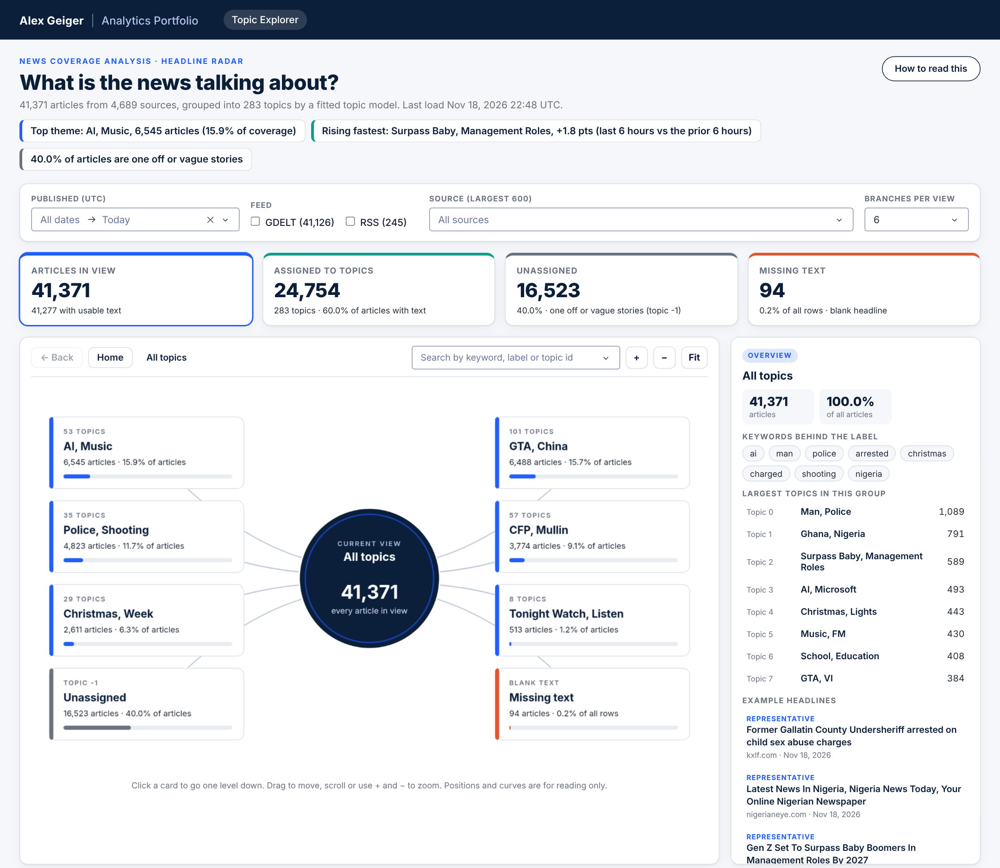
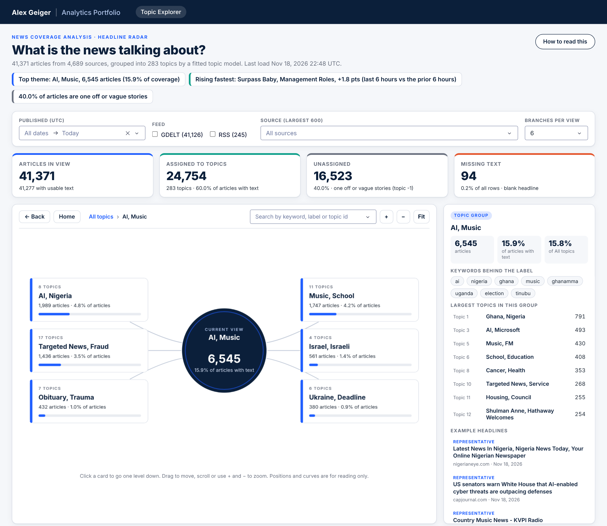
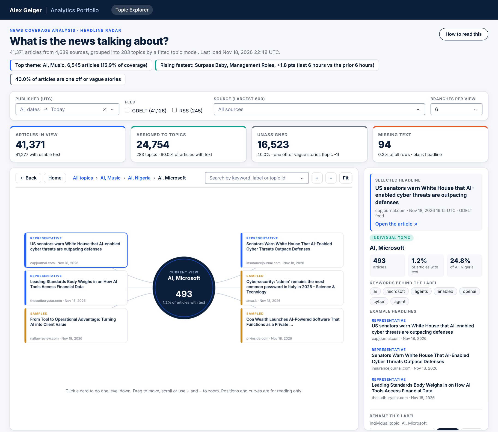
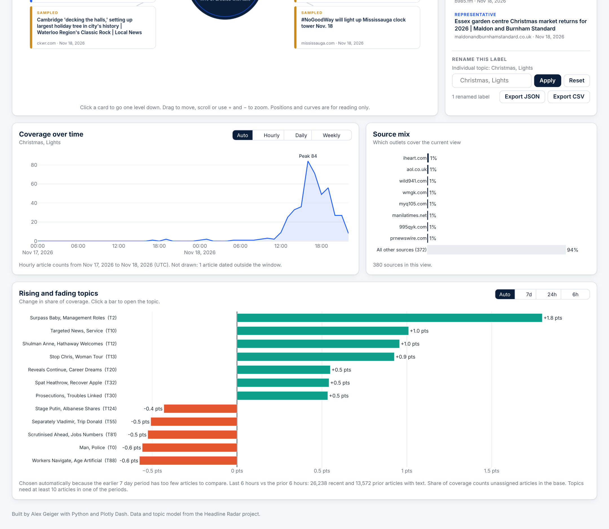
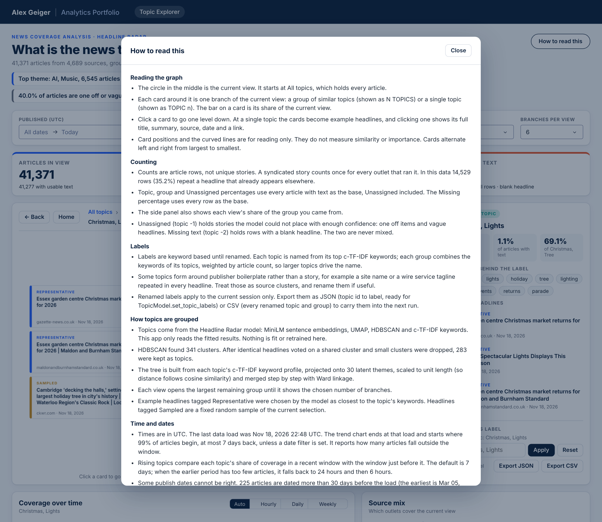
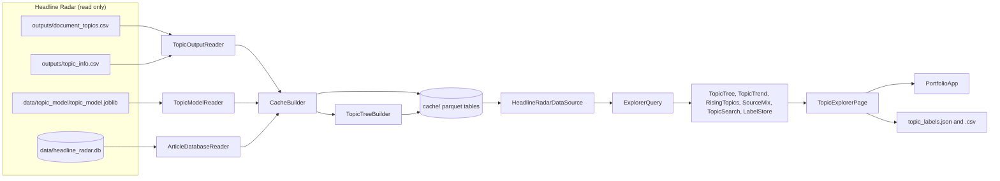

# News Topic Explorer

**What is the news talking about, and how much coverage does each theme get?**

An interactive Plotly Dash app that turns 41,371 news articles into a map you can walk through: start from the whole corpus, open one theme at a time, and end on the actual headlines. It is the first page of my analytics portfolio app and reads the fitted results of Headline Radar, my own BERTopic style topic model.

**[Run it in three commands](#run-it)** &nbsp;\|&nbsp; [Data flow](#data-flow) &nbsp;\|&nbsp; [Code highlights](#code-highlights) &nbsp;\|&nbsp; [Sources](#sources)



## Why it matters

Newsrooms, comms teams and analysts all face the same problem: thousands of headlines a day and no time to read them. A topic model can sort them, but a table of 283 keyword lists is not an answer anyone can act on. This explorer presents the model the way a consultant would present a topic analysis:

* **One question, answered top down.** The first screen shows the share of coverage each theme gets. Every click goes one level deeper until you reach real headlines.
* **Honest numbers.** Unassigned stories (40% of this corpus) and blank rows are shown, counted and explained instead of hidden.
* **Time aware.** News moves by the hour, so every selection comes with its trend, its source mix and a rising and fading view.
* **Human labels.** Keyword names are a starting point. Analysts can rename them in the app and export the labels back to the pipeline.

## What it shows

| View | What you learn |
| --- | --- |
| Summary cards | Articles in view, how many landed in a topic, how many are unassigned, how many have no text. Each card opens that group. |
| Topic graph | A hub for the current group and cards for its branches, each with a share bar. Click to drill down. Zoom, fit and drag are built in. |
| Side panel | Type, count, share of all articles and of the group you came from, the keywords behind the label, the largest topics and example headlines tagged Representative or Sampled. |
| Coverage over time | Hourly, daily or weekly article counts for whatever is selected. |
| Source mix | Which outlets drive the selection. |
| Rising and fading topics | Change in share of coverage, recent window against the window before it. Click a bar to open the topic. |
| Filters | Date range, feed type and source. Every card, count and chart responds. |

**Drilling into a theme.** Each view opens the largest remaining group until it shows the chosen number of branches (6 by default).



**A single topic.** The cards become example headlines. Clicking one shows the full title, summary, source, date and a link.



**Trend, source mix and rising topics** for the selection.



**How to read this.** Method notes and limits live one click away from every number.



### Key numbers from the current fit

| Measure | Value |
| --- | --- |
| Articles | 41,371 rows from 4,689 sources, last loaded Nov 18, 2026 22:48 UTC |
| With usable text | 41,277 |
| Assigned to a topic | 24,754 (60.0% of articles with text) across 283 topics |
| Unassigned (topic -1) | 16,523 (40.0%) |
| Missing text (topic -2) | 94 (0.2% of all rows) |
| Largest themes | AI and Music cluster 6,545 (15.9%); GTA and China cluster 6,488 (15.7%); Police and Shooting 4,823 (11.7%) |
| Largest topic | Topic 0, Man and Police (crime and arrests), 1,089 articles |
| Fastest riser | Topic 2, Gen Z set to surpass baby boomers in management roles, +1.8 points of share in the last 6 hours |

## Code highlights

* **Read only by design.** The app never fits or retrains anything. `CacheBuilder` reads the pipeline's CSV outputs, the pickled model attributes and the SQLite database (opened with `mode=ro`), joins them on article id with `validate="many_to_one"` and writes small parquet tables. The app starts in about two seconds from that cache.
* **A tree that reads well.** Raw c-TF-IDF profiles share so few exact words that Ward linkage on them collapses into one long chain. `TopicTreeBuilder` first projects the profiles onto 30 latent themes (truncated SVD), scales them to unit length so distance follows cosine similarity, then merges with Ward. The top level went from one branch holding 93% of articles to six balanced themes.
* **Names weighted by size.** `KeywordNamer` combines each topic's keywords, weighted by article count, so larger topics drive the group name. A group never reuses a name from inside its own branch, so breadcrumbs always read as distinct steps.
* **Pluggable data.** Pages talk to `AbstractDataSource`. `HeadlineRadarDataSource` serves the cache, and `FrameDataSource` serves in memory tables for tests. A new dataset only needs a new source.
* **Pluggable pages.** `PortfolioApp` registers any list of `AbstractPage` objects as Dash pages inside one shared shell, and the navigation builds itself from them.
* **Fast callbacks.** Filters are one boolean mask over 41k rows, branch counts are sums over precomputed topic lists, and a full view renders in about 30 ms.
* **Small, readable classes.** One class per file, named after the file. Analytics classes have no Dash imports, so they are easy to test and reuse.

## Data flow



## Run it

Python 3.11 or newer. Headline Radar's fitted outputs must sit in a sibling folder named `headline-radar`, or set `HEADLINE_RADAR_PATH`.

```bash
python -m venv .venv && source .venv/bin/activate
pip install -e ".[build,dev]"
python build_cache.py      # once, or after the topic model is refit
python app.py              # then open http://127.0.0.1:8050
```

The `build` extras (`umap-learn`, `hdbscan`, `joblib`) are only needed by `build_cache.py`, because the model file pickles those objects. The app itself only reads the cache. Set `PORT` or `HOST` to change where it listens.

Tests and style checks:

```bash
pytest
ruff check . && ruff format --check .
```

Tests use small hand made fixtures, never the real corpus.

### Repository layout

```text
app.py                  start the portfolio app
build_cache.py          build the cache from Headline Radar outputs
config/                 Settings, Theme, Formats
data/                   readers, CacheBuilder and data sources
analytics/              tree building, navigation, trends, search, labels
components/             cards, graph, side panel, charts, shell, notes
pages/                  AbstractPage and TopicExplorerPage
portfolio/              PortfolioApp
assets/style.css        the shared theme
tests/                  pytest suite with small fixtures
docs/images/            screenshots captured from the running app
```

### Label export format

`Export JSON` writes `topic_labels.json`, a map from topic id to label that the pipeline can apply on its next run:

```python
labels = {int(topic): label for topic, label in json.load(open("topic_labels.json")).items()}
model.set_topic_labels(labels)
```

`Export CSV` writes `topic_labels.csv` with `node_key, kind, topic_id, keyword_name, label` for every renamed topic and group.

### Data notes

* Counts are article rows, not unique stories. 14,529 rows (35%) repeat a headline that already appears, mostly syndicated copies. Topic 2, the fastest riser, is a single iheart.com headline syndicated 589 times, a good reminder that rising share can mean wide syndication rather than many stories.
* 94 database rows have a blank headline. The pipeline skips them, so the explorer adds them back as Missing text (topic -2).
* 225 articles carry publish dates more than 30 days before the load (the earliest is March 2004) and 27 are dated after the load. They stay in every count; the trend chart reports them instead of drawing them.
* Almost all articles were published on Nov 18, 2026, so the rising view falls back from 7 days to the last 6 hours, and says so on screen.
* A few topics form around publisher boilerplate (a site name or wire service tagline) rather than a story.
* The saved model holds two placeholder labels (`Topic 0 (man)`, `Topic 1 (ghana)`) that the pipeline's own outputs do not use, so the explorer starts from keyword names.

## Sources

* Grootendorst, M. (2022). BERTopic: Neural topic modeling with a class based TF-IDF procedure. arXiv:2203.05794.
* Reimers, N. and Gurevych, I. (2019). Sentence-BERT: Sentence embeddings using Siamese BERT networks. EMNLP. Model: sentence-transformers/all-MiniLM-L6-v2.
* McInnes, L., Healy, J. and Melville, J. (2018). UMAP: Uniform Manifold Approximation and Projection for dimension reduction. arXiv:1802.03426.
* Campello, R., Moulavi, D. and Sander, J. (2013). Density based clustering based on hierarchical density estimates. PAKDD. McInnes, L., Healy, J. and Astels, S. (2017). hdbscan: Hierarchical density based clustering. JOSS.
* Deerwester, S. et al. (1990). Indexing by latent semantic analysis. Journal of the American Society for Information Science.
* Ward, J. H. (1963). Hierarchical grouping to optimize an objective function. Journal of the American Statistical Association.
* The GDELT Project, gdeltproject.org, and the publishers' RSS feeds collected by Headline Radar.
* Plotly Dash and Dash Cytoscape, dash.plotly.com.
